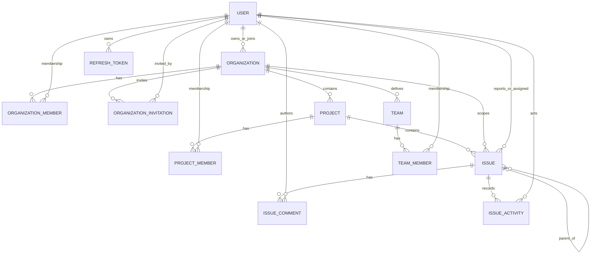
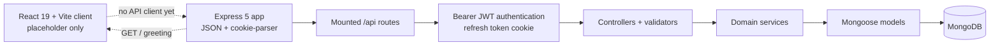

# Worklyn

> Repository-grounded product and UI/UX brief. This document describes the code present in this repository on 18 October 2026. “Implemented” below means present in source; the repository has no automated tests, so it does not imply runtime verification.

## 1. Worklyn Overview

Worklyn is an early-stage, Jira-inspired project and issue management application. The backend implements local account registration and email OTP verification, organization membership and invitations, projects and project membership, issue creation/list/detail/update, comments, and issue activity records. The frontend is currently a single React placeholder (“Hello from client”) with no application routes, screens, API integration, or authentication UI.

The central domain hierarchy is Organization → Project → Issue. Users need active organization and project memberships to work with project issues. A project has a `SCRUM` or `KANBAN` type, but neither board experience is implemented in this repository. No sprint entity or endpoints exist.

## 2. Product Vision and Target Users

**Vision:** give small product teams a calm, dependable place to agree on work, track ownership, and see changes without making routine coordination feel like administration.

**Target users:** developers, designers, QA engineers, project managers, startup founders, product teams, students, and other collaborative teams. These are intended audiences, not user research findings; no research artifacts were found.

Useful outcomes for a future UI: help people know their organization, project, and current task; make high-value work easy to find; keep common actions consistent; expose progress and ownership clearly; and remain readable during long sessions. Visual attractiveness is a pleasant first impression. Usability is whether people can locate the right work, understand its state, take a permitted action, and recover from errors with low effort. The former should support, not substitute for, the latter.

## 3. Current Implementation Status

| Area | Status | Evidence / limit |
|---|---|---|
| Frontend shell | Implemented, verification pending | `client/src/App.jsx` renders only a heading; Vite/React entry exists. |
| Frontend product pages and routes | Missing | No router dependency, route definitions, or page components. |
| Authentication and refresh tokens | Implemented, verification pending | Backend registration, email OTP, login, `/me`, refresh, logout. No UI, email delivery integration, or tests. |
| Organizations and invitations | Implemented, verification pending | CRUD-like organization operations, membership administration, invitation lifecycle. No organization UI. |
| Projects and project membership | Implemented, verification pending | Create/list/detail and member add/update/remove APIs. No project UI. |
| Issues, comments, activity | Implemented, verification pending | CRUD subset, filtering/pagination, comments, and recorded update activity. No issue UI. |
| Teams | Partial | `Team` and `TeamMember` models exist; no routes/controllers/services reference them. |
| Scrum/Kanban boards, sprints, dashboards, reports | Missing | Project type enum exists; no corresponding board/sprint/report APIs or frontend. |
| Runtime behavior | Not verified | No tests; no database or external-service credentials were inspected or used. |

## 4. Technology Stack

| Layer | Observed dependencies and versions |
|---|---|
| Client | React `^19.2.8`, React DOM `^19.2.8`, Vite `^8.3.0`, `@vitejs/plugin-react` `^6.1.1`, Tailwind CSS `^4.3.3`, `@tailwindcss/vite` `^4.3.3` |
| Server | Node.js/CommonJS source; Express `^5.2.1`, Mongoose `^9.10.2`, `dotenv` `^18.0.3`, `cookie-parser` `^1.4.7`, `cors` `^2.8.6`, `bcryptjs` `^3.0.3`, `jsonwebtoken` `^9.0.3`, `nodemon` `^3.1.14` |
| Database | MongoDB through Mongoose; connection uses environment variable name `MONGO_URI` |
| Styling | Tailwind CSS v4 Vite plugin and `@import "tailwindcss"`; no component library or token setup found |
| State/data/forms/icons/motion | No client state manager, API client, form library, icon library, or animation dependency found |
| Package management | `client/package-lock.json` and `server/package-lock.json` indicate npm lockfiles |

Versions above are declared package ranges, not claims about installed runtime versions. No root package manifest, test suite, Dockerfile, deployment manifest, or CI configuration was found. `client` scripts are `dev`, `build`, `lint`, and `preview`; server scripts are `start` and a placeholder `test` that exits with “no test specified”.

## 5. Repository Structure

```text
client/
  index.html
  package.json
  vite.config.js
  src/App.jsx                 # Placeholder only
  src/main.jsx                # React root and global CSS entry
  src/index.css               # Tailwind import
  src/App.css                 # Empty/minimal stylesheet
server/
  server.js                   # dotenv, DB connect, Express listen, GET /
  app.js                      # Middleware and route mounting
  config/db.js                # Mongoose connection
  routes/                     # Express route declarations
  controllers/                # HTTP request/response handlers
  services/                   # Domain/database operations
  middlewares/                # Authentication and access/role checks
  models/                     # Mongoose schemas (`user.js` has lowercase filename)
  validators/                 # Request validation helpers
  utils/                      # Password/token/OTP helpers
postman/                      # Postman assets (not runtime code)
.postman/                     # Postman assets (not runtime code)
```

Environment variable names evidenced in code: `PORT`, `MONGO_URI`, `JWT_ACCESS_SECRET`, `JWT_REFRESH_SECRET`, `NODE_ENV`, `FRONTEND_URL`. Values are deliberately not documented. The server loads dotenv, starts the connection without awaiting it, then listens; operational readiness behavior is not verified. CORS is installed as a dependency but not configured or mounted in `server/app.js`.

## 6. Application Routes and Page Inventory

There are no frontend routes. `client/src/App.jsx` is the only page-level component located. Future screen names in later sections are proposals, not existing routes.

| Page/Route | Component | Purpose | Current Status | Data/API Dependencies | Missing UI States |
|---|---|---|---|---|---|
| `/` (Vite app entry; not a client-side route) | `client/src/App.jsx` | Displays “Hello from client” | Placeholder, not a product page | None | All product loading, error, empty, success, auth, and responsive states |

There are no protected frontend routes, layout components, navigation, shared UI primitives, forms, or client-side error handling. Protection exists only in backend middleware and is described below. No responsive behavior or accessibility implementation can be verified from the placeholder.

## 7. Backend API Inventory

All paths below are prefixed by `/api`, as mounted in `server/app.js`. Except where marked public, routes use `authenticate`, which expects an `Authorization: Bearer <access-token>` header and rejects deleted, deactivated, or unverified accounts. Organization/project access checks additionally require active membership. Request and response shape descriptions reflect controllers and validators; unlisted fields should not be inferred. Error envelopes generally contain `{ success: false, message }`, sometimes `errors`.

| Method | Actual endpoint | Purpose | Authentication / authorization | Request and response (verified from code) | Status |
|---|---|---|---|---|---|
| POST | `/api/auth/register` | Register local account | Public | Body: `firstName`, `lastName`, `email`, `password`, optional `mobile`; returns `data.userId`, `data.email`. | Implemented, verification pending |
| POST | `/api/auth/verify-email` | Verify email OTP | Public | Body `userId`, six-digit `otp`; returns verification result. | Implemented, verification pending |
| POST | `/api/auth/resend-verification` | Issue another OTP | Public | Body `email`; returns email. | Implemented, verification pending |
| POST | `/api/auth/login` | Password login | Public | Body `email`, `password`; response includes `data.user`, `data.accessToken`; refresh token set as HttpOnly cookie. | Implemented, verification pending |
| GET | `/api/auth/me` | Read current user | Bearer token | Returns `data.user` from auth middleware. | Implemented, verification pending |
| POST | `/api/auth/refresh` | Rotate refresh/access tokens | Refresh-token cookie | Sets replacement cookie; returns `data.accessToken`. | Implemented, verification pending |
| POST | `/api/auth/logout` | Revoke refresh token and clear cookie | Cookie-based; no `authenticate` middleware | Cookie is optional to service behavior; returns success message. | Implemented, verification pending |
| POST | `/api/organization` | Create organization and owner membership | Bearer token | Validated name/slug/optional description; returns `data.organization`. | Implemented, verification pending |
| GET | `/api/organization/my` | List active organizations for user | Bearer token | Returns `data.organizations` with organization, role, membership ID. | Implemented, verification pending |
| GET | `/api/organization/:organizationId` | Organization detail | Active organization member | Returns organization and caller role. | Implemented, verification pending |
| PUT | `/api/organization/:organizationId` | Update organization | Owner or admin | Optional validated name, description, logo; returns organization. | Implemented, verification pending |
| GET | `/api/organization/:organizationId/members` | List active organization members | Active organization member | Returns `data.members`; user population includes name/email/profile image. | Implemented, verification pending |
| POST | `/api/organization/:organizationId/invitations` | Create invitation | Owner or admin | Validated email/role; returns invitation and development invitation link. | Implemented, verification pending |
| DELETE | `/api/organization/:organizationId/invitations/:invitationId` | Cancel pending invitation | Owner or admin | Returns updated invitation. | Implemented, verification pending |
| POST | `/api/organization/:organizationId/invitations/:invitationId/resend` | Rotate invitation token/expiry | Owner or admin | Returns invitation and development invitation link. | Implemented, verification pending |
| PATCH | `/api/organization/:organizationId/members/:memberId/role` | Change member role | Owner only | Body `role` (`ADMIN` or `MEMBER`); returns member. | Implemented, verification pending |
| DELETE | `/api/organization/:organizationId/members/:memberId` | Remove active member | Owner only | Soft marks membership removed; returns member. | Implemented, verification pending |
| DELETE | `/api/organization/:organizationId/leave` | Leave organization | Active member; owner must transfer first | Returns success message. | Implemented, verification pending |
| PATCH | `/api/organization/:organizationId/transfer-ownership` | Transfer organization owner | Owner only | Body `newOwnerMemberId`; transaction updates org and both memberships. | Implemented, verification pending |
| POST | `/api/invitations/accept` | Accept invitation | Bearer token; invitation email must match user | Body `token`; returns organization and granted role. | Implemented, verification pending |
| POST | `/api/organizations/:organizationId/projects` | Create project | Active org member; owner/admin | Project fields include name, key, slug; optional description, type, lead. Creator becomes project admin. Returns project. | Implemented, verification pending |
| GET | `/api/organizations/:organizationId/projects/my` | List caller’s active projects in organization | Active org member | Returns projects with caller role and membership ID. | Implemented, verification pending |
| GET | `/api/projects/:projectId` | Project details | Active org and project member | Returns project and caller role. | Implemented, verification pending |
| POST | `/api/projects/:projectId/members` | Add active org user to project | Project admin | Body `userId`, role `MEMBER` or `VIEWER`; returns membership. No invitation workflow here. | Implemented, verification pending |
| PATCH | `/api/projects/:projectId/members/:memberId/role` | Change project member role | Project admin | Body `role` `MEMBER` or `VIEWER`; returns membership. | Implemented, verification pending |
| DELETE | `/api/projects/:projectId/members/:memberId` | Remove project member | Project admin | Soft marks removed; protects last active project admin. | Implemented, verification pending |
| POST | `/api/projects/:projectId/issues` | Create issue | Active org and project member | Body title, optional description/type/priority/assigneeId/parentIssueId/labels/dueDate/estimate; returns issue. | Implemented, verification pending |
| GET | `/api/projects/:projectId/issues` | List/filter project issues | Active org and project member | Query page (default 1), limit (default 10, max 100), status/type/priority/assignee/search; returns issue array and pagination metadata. Search matches title/key. | Implemented, verification pending |
| GET | `/api/issues/:issueId` | Read issue detail | Bearer token plus active org and project membership in service | Returns populated issue. | Implemented, verification pending |
| PATCH | `/api/projects/:projectId/issues/:issueId` | Update issue fields | Active org/project member; viewers cannot update; valid status transitions enforced | Body supports title, description, status, priority, type, assignee, labels, dueDate, estimate; returns populated issue. | Implemented, verification pending |
| GET | `/api/issues/:issueId/activities` | Read issue change log | Active org and project membership via `issueAccess` | Returns activity array. | Implemented, verification pending |
| POST | `/api/projects/:projectId/issues/:issueId/comments` | Add comment | Active org/project member | Body `body`; returns populated comment. | Implemented, verification pending |
| GET | `/api/projects/:projectId/issues/:issueId/comments` | Paginated comments | Active org/project member | Query validated by `issueComment.validator.js`; response includes comments and pagination. Exact pagination defaults are validator-defined. | Implemented, verification pending |
| PATCH | `/api/projects/:projectId/issues/:issueId/comments/:commentId` | Edit own comment | Active org/project member; author-only in service | Body `body`; returns comment with edited timestamp. | Implemented, verification pending |
| DELETE | `/api/projects/:projectId/issues/:issueId/comments/:commentId` | Soft-delete own comment | Active org/project member; author-only in service | Marks deleted and replaces body with `[deleted]`; returns comment ID. | Implemented, verification pending |
| GET | `/` | Server health-like greeting | Public | Plain text `Hello World!`; no health/readiness contract established. | Implemented, verification pending |

Validation is implemented through per-domain helper files in `server/validators/`; there is no shared validation framework. Pagination, allowlisted filters, escaping of search regex metacharacters, and status transition rules exist for issue listing/updating. No general global error middleware, API versioning, OpenAPI spec, or consistent response schema is present. `cors` is a dependency but the app has no CORS middleware configuration. No upload, email provider, notification delivery, websocket, queue, scheduler, or background job integration was found.

## 8. Database Models and Relationships

All models use Mongoose timestamps unless otherwise noted. The schema is MongoDB document references, not relational foreign keys; referential integrity is enforced selectively in service code. `Team` and `TeamMember` are defined but disconnected from API workflows.

| Model | Relevant fields / rules |
|---|---|
| `User` (`server/models/user.js`) | Required trimmed first/last name (max 50), unique lowercase email, optional unique sparse mobile, password hash, profile image, verification/deactivation/deletion state, OTP and expiry, provider IDs, last login, provider enum local/google/facebook. Timestamps. Google/Facebook IDs are not evidence of implemented OAuth routes. |
| `RefreshToken` | User ref, unique token hash, expiry, revoked timestamp, user agent, IP; timestamps and user/expiry indexes. |
| `Organization` | Required name (max 100), unique lowercase slug, description (max 500), logo, owner User ref, mixed settings, active flag; timestamps. Schema explicitly declares created/updated defaults as well as `timestamps`. |
| `OrganizationMember` | Organization/User refs, role OWNER/ADMIN/MEMBER, status ACTIVE/INVITED/SUSPENDED/REMOVED, inviter, joinedAt; unique organization+user; timestamps. |
| `OrganizationInvitation` | Org ref, lowercase email, role ADMIN/MEMBER, unique indexed token hash, inviter, status PENDING/ACCEPTED/REJECTED/EXPIRED/CANCELLED, expiry and lifecycle dates; timestamps; org/email/status index. |
| `Project` | Organization ref, name, key, slug, description, avatar, projectType SCRUM/KANBAN, lead/creator User refs, status ACTIVE/ARCHIVED, mixed settings, issueCounter; timestamps; unique org+key and org+slug. |
| `ProjectMember` | Project/User refs, role PROJECT_ADMIN/MEMBER/VIEWER, status ACTIVE/INVITED/REMOVED, inviter, joinedAt; unique project+user; timestamps. |
| `Issue` | Org/Project refs, positive issue number and key, required title (3–200), description (max 10,000), type EPIC/STORY/TASK/BUG/SUB_TASK, status BACKLOG/TODO/IN_PROGRESS/IN_REVIEW/DONE, priority LOWEST/LOW/MEDIUM/HIGH/HIGHEST, reporter/optional assignee/optional parent Issue refs, labels, dueDate, nonnegative estimate, archivedAt; timestamps; unique project+number and project+key; project/status/createdAt index. |
| `IssueComment` | Org/Project/Issue/author refs, required trimmed body (1–5,000), editedAt/deletedAt; timestamps; issue/deletedAt/createdAt index. Soft deletion is used. |
| `IssueActivity` | Org/Project/Issue/actor refs, action ISSUE_CREATED/ISSUE_UPDATED/STATUS_CHANGED, changes array with field and mixed from/to values; timestamps; issue/createdAt index. |
| `Team` | Organization ref, name, description, avatar, creator, active flag; timestamps; unique org+name. No API found. |
| `TeamMember` | Team/User refs, role TEAM_LEAD/MEMBER, status ACTIVE/INVITED/REMOVED, joinedAt; timestamps; unique team+user. No API found. |



Diagram edges indicate references and conceptual one-to-many navigation; they do not guarantee populated relations or cascade behavior. `Issue` subtask hierarchy is only one level deep: a subtask must have a non-subtask parent in the same project.

## 9. Existing Features and Feature Matrix

| Feature | Status | Evidence / boundary |
|---|---|---|
| Authentication | Implemented, verification pending | Local password register/login, email OTP, bearer access JWT, rotating refresh cookie, logout. Email OTP is logged to server console; no email integration. |
| User profile | Partial | User fields and `/auth/me`; no profile update, password reset, or profile page. |
| Organization | Implemented, verification pending | Create, list, detail, update, leave, transfer ownership. |
| Organization members/roles | Implemented, verification pending | List, role update, remove; roles OWNER/ADMIN/MEMBER. |
| Invitations | Implemented, verification pending | Create/cancel/resend/accept; token hashed at rest and 7-day expiry; links returned for development, no email sender. |
| Projects | Implemented, verification pending | Create, list caller’s projects, detail, ACTIVE/ARCHIVED state; no archive endpoint. |
| Project members/roles | Implemented, verification pending | Add existing active org user, update role, remove. |
| Teams | Partial | Schemas only, no service/API/UI. |
| Roles and permissions | Partial | Org/project access and role checks exist; no frontend policy/UI and not all route semantics consistently return typed errors. |
| Issues: epic/story/task/bug/subtask | Implemented, verification pending | Issue type enum; parent rule for one-level subtasks. No dedicated epic hierarchy behavior. |
| Issue assignment | Implemented, verification pending | Assignee must be active org and project member. |
| Priority and status | Implemented, verification pending | Enums and constrained transitions; no board or status controls in client. |
| Comments | Implemented, verification pending | Create/list/edit/delete own comments; soft delete. |
| Activity history | Partial | Issue update writes change entries and read endpoint exists; creation activity is an allowed enum but creation service does not record it. |
| Attachments | Missing | No schema, upload middleware, storage integration, or endpoint. |
| Labels | Implemented, verification pending | String array on issue, create/update/list; no label management taxonomy. |
| Issue relationships | Partial | Parent reference only for subtasks; no blocks/relates/duplicates links. |
| Backlog | Partial | `BACKLOG` status and list filter exist; no backlog page, ranking, or backlog workflow. |
| Sprints | Missing | No model, route, or service. |
| Scrum board | Missing | Project type option only; no board API/page. |
| Kanban board | Missing | Project type option only; no board API/page. |
| Drag and drop | Missing | No frontend implementation. |
| Search and filters | Partial | Project issue API filters by status/type/priority/assignee, text search, pagination; no global search or saved filters/UI. |
| Notifications | Missing | No notification model/delivery/API/UI. |
| Dashboards/reports | Missing | No aggregation/report API or page. |
| Project settings | Partial | Project schema has mixed settings; no settings endpoint/page. |
| User-facing client | Missing | Placeholder only; API not connected to the browser. |

Status meaning: **Complete and verified** would require runtime/test evidence (none is available here); **Implemented, verification pending** indicates implementation visible in source but no runtime verification; **Partial** means only a subset/layer exists; **Missing** means no implementation located; **Planned** is reserved for roadmap proposals and does not imply a commitment.

## 10. Actual User Workflows

### Account registration and login

1. Client would submit registration fields to `/api/auth/register` (no client exists).
2. Controller validates input; service hashes password, creates unverified user, generates a 10-minute OTP, logs OTP to server console.
3. User submits user ID + OTP to `/api/auth/verify-email`; service marks verified and clears OTP fields.
4. User submits email/password to `/api/auth/login`; service checks account state and password, persists hashed refresh token metadata, returns access token and sets refresh token cookie.
5. Protected requests send bearer access token; `/api/auth/refresh` rotates refresh token through cookie.

Known limitation: email is not sent; registration/verification screens and browser token storage/refresh behavior are absent. A frontend must preserve bearer + HttpOnly-cookie semantics and coordinate cookie credentials with deployment/CORS before auth can work cross-origin.

### Organization and invitation

An authenticated user creates an organization; service creates OWNER membership. Active users can list their organizations and inspect details/members. Owner/admin can create invitations for ADMIN or MEMBER; token is hashed in DB and link returned in response. The invited user must be authenticated as the same email and POST the raw token to `/api/invitations/accept`; membership becomes active and invitation accepted. Owner can update roles, remove members, or transfer ownership; non-owner members can leave. There is no invitation page, email delivery, pending-invitation listing endpoint, or members UI.

### Project and membership

An org owner/admin creates a project; project creation and creator’s PROJECT_ADMIN membership use a MongoDB transaction. Active organization members can list their own active projects. Project access requires both active org and project membership. Project admins add existing active organization users as MEMBER/VIEWER and can change/remove membership; the final active project admin cannot be removed. No project creation/list/settings screens are present.

### Issue lifecycle

An active project member can create an issue. The API assigns an incremented issue number/key from the project counter, records reporter, validates assignee membership, and validates an optional same-project parent for SUB_TASK. List supports pagination/filter/search and returns populated reporter/assignee/parent. Detail checks both memberships. Update rejects VIEWER, validates fields and status transitions, saves changes, and records an activity entry when a value changes. Current transition graph: BACKLOG→TODO; TODO↔BACKLOG or TODO→IN_PROGRESS; IN_PROGRESS→TODO or IN_REVIEW; IN_REVIEW→IN_PROGRESS or DONE; DONE→IN_REVIEW. No UI, board ordering, optimistic update behavior, or activity timeline presentation exists.

### Comments and activity

An active project member can create/list comments; only a comment’s author can edit or soft-delete it. Listing is paginated. Issue activities are readable by active org/project members. Activity is recorded by issue update, but issue creation does not currently create an activity entry despite the model allowing that action. No notifications are triggered by comments, assignment, or status changes.

### Unsupported workflows

Backlog prioritization, sprint creation/planning, Scrum/Kanban boards, drag/drop, teams management, global search, dashboards/reports, attachments, notification inbox, and user profile editing cannot be established as supported workflows.

## 11. Product Architecture Diagram



The browser-to-API arrow is dashed because no frontend request code exists. `server/server.js` loads dotenv, calls `connectDB()`, adds `/`, and listens on `PORT` (default 5000); `server/app.js` parses JSON and cookies and mounts routers. No configured CORS layer is present.

## 12. Database ER Diagram

See the model diagram in section 8. No sprint, notification, attachment, workflow configuration, or board model exists. Teams are schema-only. Avoid designing UI that depends on these as if they were persisted capabilities.

## 13. Worklyn Visual Identity

### Recommended direction: “Workshop Signal”

Build a warm, precise workshop atmosphere: ink-like navy text, soft mineral-gray canvas, clear white/near-white working surfaces, and a bright but controlled citrus-lime signal for primary actions and progress. Use a small supporting set of blue, amber, coral, and green semantic colors. Convey craft through sharp typography, compact issue identifiers, editorial project headers, deliberate alignment, and small status marks. Avoid copying Jira’s recognizable blue-heavy shell and avoid the generic purple-gradient dashboard look.

This direction fits a developer-focused product because the neutral base supports dense information, the high-energy signal helps action and progress stand out, and color can remain restrained enough for long sessions. Use project identity through simple initials/monograms or user-provided imagery; do not imply the project avatar is uploaded/stored in a working UI until that capability exists.

### Recommended tokens

These are design proposals, not existing application styles. Check contrast in actual UI states before shipping.

| Token | Suggested value | Use |
|---|---|---|
| `canvas` | `#F4F5F2` | Main app background |
| `surface` | `#FFFFFF` | Main panels and menus |
| `surface-subtle` | `#EAEEE9` | Secondary regions, selected table rows |
| `surface-raised` | `#FFFFFF` | Dialogs and popovers; distinguish with border/shadow |
| `ink` | `#17231D` | Primary text |
| `ink-muted` | `#59665F` | Secondary text, icons |
| `ink-faint` | `#748078` | Tertiary metadata; never use for essential text without contrast check |
| `border` | `#D8DED8` | Dividers and control borders |
| `accent` | `#B8F04A` | Primary action, progress highlight; use dark ink foreground |
| `accent-strong` | `#8FCA24` | Hover/active accent; check foreground contrast |
| `accent-support` | `#316B59` | Links, selected navigation, secondary emphasis |
| `status-backlog` | `#6E7880` | Backlog |
| `status-todo` | `#316B9A` | To do |
| `status-progress` | `#8A5A00` | In progress |
| `status-review` | `#8053A6` | In review |
| `status-done` | `#26734D` | Done |
| `priority-low` | `#68766E` | Lowest/low |
| `priority-medium` | `#316B9A` | Medium |
| `priority-high` | `#B26017` | High |
| `priority-highest` | `#B33C3C` | Highest |

Use status labels and icons/text in addition to hue. Don’t use lime for large surfaces. Keep destructive actions red and explicit; do not rely on color alone.

**Typography:** use a neutral, highly legible sans-serif such as Inter or a system stack for interface text; use a restrained mono face for issue keys and estimates only. No font dependency is currently installed. Suggested scale: 12 metadata, 14 dense controls/table text, 16 body, 20 section title, 24–28 page title; keep labels comfortably readable and avoid tiny all-caps navigation.

**Spacing:** 4px base rhythm: 4, 8, 12, 16, 20, 24, 32, 40, 48. Dense tables may use 8–12px cell padding; page sections 24–32px. **Radius:** 6px controls, 10px panels, 14px dialogs; avoid pill-shaped everything. **Shadows:** subtle elevation only for floating layers; use borders for structural separation. **Motion:** 120–180ms for hover/focus, up to 220ms for panel transitions; respect `prefers-reduced-motion`, avoid looping animation, and never make animation the only feedback.

## 14. UX Principles and Interaction Guidelines

- **Navigation:** establish organization → project → project area hierarchy. Keep current organization/project visible; provide a compact, collapsible sidebar with predictable active states. Do not expose unimplemented areas as working destinations; mark future areas only in internal prototypes.
- **Search:** begin with project issue search because that API exists. Convey scope and supported filters; global search and saved filters need backend support before being represented as functional.
- **Breadcrumbs:** show contextual organization/project/issue path and preserve a clear return target from issue detail.
- **Create actions:** make “Create issue” easy to reach in project context. Use one shared form pattern; show type, title, description, priority, assignee, parent for subtask, labels, due date, and estimate only where appropriate. Avoid implying sprint fields.
- **Issue detail:** show key, title, status, priority, assignee, reporter, labels, due date, estimate, description, parent, comments, and activity when loaded. Use inline edits only when permission allows; make status transitions match backend rules and explain rejected transitions.
- **Forms:** label every field, preserve entered values after recoverable errors, show field-level validation from `{ errors }`, and distinguish validation, permission, network, and server failures.
- **Keyboard/accessibility:** semantic buttons/inputs, visible focus ring, logical tab order, dialog focus trap and restoration, screen-reader labels for icon controls, keyboard-accessible menus. Do not make drag/drop the only way to change work state.
- **Loading/success:** skeletons for stable layouts, button-level pending states, clear success feedback. Current backend does not establish optimistic-update or retry contracts; prefer confirmed server response first and reconcile on failure.
- **Empty/error states:** explain what is empty and the next supported action. Distinguish no projects, no matching issues, no comments, and no permission. Offer retry for transient failures without discarding form contents.
- **Destructive actions:** confirm member removal and other irreversible/high-impact actions; state the affected person/project and consequences. Invitation cancellation and soft removals should be described accurately.
- **Responsive:** prioritize desktop density, then tablet layouts with collapsible navigation; at narrow widths convert tables to stacked issue rows or horizontally scroll only where necessary. Keep create/edit and issue detail usable by touch.
- **Delight:** compact issue-key chips, restrained transitions on confirmed status changes, satisfying but brief completion feedback, useful hover/focus affordances, skeletons, and empty states with a clear next action. Keep motion quiet during long sessions.

## 15. Page-by-Page UI Design Specification

No product page currently exists. Items below are **proposed future pages**, and dependencies describe existing API capability versus additional work.

| Proposed page | User goal and hierarchy | Actions/data and API | States, responsive/accessibility, limitation |
|---|---|---|---|
| Login | Return to work; brand/context, email/password form, verification guidance | Login; `POST /api/auth/login`; `/auth/refresh`, `/auth/me` for session restore | Invalid credentials, unverified account, pending, server error. Accessible labels, password visibility control. No client auth contract exists yet. |
| Registration + verification | Create account and verify email | Register, OTP verify/resend endpoints | Validation, duplicate account, OTP expired/invalid, resend pending. OTP currently appears only in server logs, so actual email journey is incomplete. |
| Home / organization chooser | Select an organization and resume recent work | `GET /api/organization/my`; optionally create organization | Empty organizations, loading/error. No recents/dashboard endpoint; don’t fabricate activity summaries. |
| Projects list | Find/create a project in selected organization | `GET /api/organizations/:id/projects/my`, `POST /api/organizations/:id/projects` | Empty, filtered (client-side only unless supported), creation errors. Project type SCRUM/KANBAN is metadata, not board availability. |
| Project overview | Understand project identity and navigate to issues | `GET /api/projects/:projectId` | Loading/error/no access. No project overview metrics endpoint. Keep first release focused on project basics and issue list. |
| Issue list | Find and scan work | `GET /api/projects/:id/issues` with supported filters/search/pagination | No issues/no matches/loading/error. Table adapts to narrow rows; accessible sort only if implemented (API has fixed updatedAt ordering). |
| Create issue | Capture actionable work | Issue POST; project member list data is not currently exposed by a project-member list endpoint, so assignee picker needs API addition or another confirmed source | Validation, submit, success. Subtask parent required. No workflow/sprint selection. |
| Issue detail | Understand and update one issue | GET issue, PATCH issue, comments GET/POST/PATCH/DELETE, activities GET | Permission-aware fields, comment empty/error, invalid transition. Preserve path context; keyboard-friendly dialog/page. |
| Organization members/settings | Manage org identity, members, invitations, roles | Organization detail/update/members/invitations/accept/cancel/resend/member role/remove/leave/transfer endpoints | Role-specific controls, pending invitations need a list endpoint (missing), confirm remove/transfer/leave. |
| Project members/settings | Manage project membership and roles | Project detail plus add/update/remove endpoints | No endpoint lists project members; member management UI needs a list API. Existing add requires active org user ID. |
| Backlog | Triage backlog issues | Issue list with `status=BACKLOG`; issue PATCH can move allowed transitions | No ordering/rank, sprint, or bulk operation API. Present simple filtered list only until supported. |
| Scrum/Kanban board | Track status columns | Issues can be listed by status and updated with transitions | **Not implementable as a complete board contract yet:** no board endpoint, ordering, sprint, or drag/drop support; project type alone is insufficient. Future design only. |
| Teams | Organize team memberships | No API | Proposed future page; requires backend endpoints and authorization semantics first. |
| Notifications | Review mentions and assignment changes | No model/API | Proposed future page; requires notification generation and delivery/read state. |
| Reports/dashboard | Understand delivery patterns | No aggregation/report API | Proposed future page; do not populate with invented metrics. |
| User profile | Review/update personal details | `/api/auth/me` read only | Edit/avatar/password flows need backend endpoints; profile read page only can show confirmed fields. |

Every implementation should include loading, error, empty, and success states even where the API’s exact failure modes need verification. Product screens, route paths, component names, and visual descriptions in this table are proposals.

## 16. Reusable Component Inventory

**Existing reusable UI components:** none identified. `App` is the only React component. Backend validators/middleware are not UI components.

**Suggested React-friendly primitives:** `AppShell`, `OrganizationSwitcher`, `ProjectNavigation`, `Breadcrumbs`, `PageHeader`, `Button`, `TextField`, `Select`, `Dialog`, `ToastRegion`, `Avatar`, `IssueKey`, `IssueTypeIcon`, `StatusBadge`, `PriorityIndicator`, `IssueRow`, `IssueList`, `IssueForm`, `MemberPicker`, `CommentThread`, `ActivityTimeline`, `EmptyState`, `InlineError`, `Skeleton`. These are design/implementation suggestions, not repository files. Build only when screens need them, keeping props aligned to actual API fields and permissions.

## 17. Frontend Implementation Guidelines

- Preserve React + Vite and Tailwind CSS v4 (`@tailwindcss/vite`, CSS `@import "tailwindcss"`). Tailwind is already configured through Vite; do not apply v3 configuration assumptions. Introduce tokens in a deliberate CSS/theme layer compatible with v4.
- Use the current React entry (`client/src/main.jsx`) and `App.jsx`; add a router only when implementing multiple pages. No router is installed today. Keep layouts composable and route protection aligned with backend bearer auth.
- Add a small API module when connecting the client. Centralize base URL, JSON/error parsing, bearer header, refresh handling, and cookie credentials; preserve `/api` paths and HttpOnly refresh cookie. The server currently has no configured CORS policy, so coordinate same-origin proxy/deployment or explicitly configure CORS before cross-origin cookie requests.
- No state manager, forms package, schema validator, icon pack, or animation package exists. Prefer React state and native form semantics initially; add dependencies only for a concrete need. Choose one icon system consistently rather than mixing emoji and unrelated sets.
- Reflect server permission outcomes; do not rely on client-side roles as security. UI hiding is a usability aid, backend is authoritative.
- Handle API errors consistently while retaining controller-specific messages and validation details. Add an error boundary for rendering failures when the multi-page app is introduced.
- Avoid optimistic writes until reconciliation is designed; status transitions and update activity are server-validated. Keep dense desktop layouts responsive and keyboard accessible.
- Existing naming uses PascalCase model filenames and camelCase route/controller/service files; follow local naming in corresponding layers. Client currently has no established component convention beyond `App.jsx`.

## 18. Missing Features and Technical Limitations

1. Frontend is an unconnected Vite shell; there is no routing, authentication UI, API client, product styling system, responsive page, or accessible interaction to assess.
2. No automated tests exist; server `test` script is a placeholder. All backend functionality is source-inspected, not runtime verified.
3. No email provider: OTP is printed in server logs; invitations return a development link and are not emailed.
4. No configured CORS middleware despite dependency; browser/API origin and cookie deployment setup are unknown.
5. No project-member listing endpoint, invitation listing endpoint, or organization pending-invitation query, limiting management UI.
6. No issue creation activity record despite `ISSUE_CREATED` enum; no notifications or email events.
7. Teams are schema-only. No uploads/storage, attachments, global search, sprint/board configuration, issue ranking, saved filters, dashboards/reports, profile updates, password reset, or OAuth flow found.
8. No global error middleware, API schema, logging framework, deployment config, CI, or explicit health/readiness route found.
9. Invitation token is surfaced in API response as a development invitation link. Production delivery/security expectations need a product decision before building invitation UX around it.
10. The user model file is named `server/models/user.js`, while backend imports use the case-sensitive path `../models/User` in several modules. Windows filesystems commonly hide this mismatch; on a case-sensitive deployment this may prevent those modules from loading and must be checked before release.

## 19. Prioritized Development Roadmap

The rows are proposals, not current commitments. “Frontend” and “backend” scope are separated to avoid designing a complete flow around unsupported contracts.

| Priority | Task | User value | Dependencies | Scope | Acceptance criteria |
|---|---|---|---|---|---|
| P0 | Establish client API/auth foundation | Users can enter the product and maintain a session | Confirm deployment origin, cookie/CORS behavior, API error shapes | FE + small BE deployment config if cross-origin | Login/refresh/logout and `/me` work without exposing refresh token to JS; clear expired-session recovery; no secret values in client. |
| P0 | Build app shell and organization/project navigation | Users know where they are and can reach existing data | Auth foundation; org/project list APIs | FE | Responsive shell, active context, loading/empty/error states, keyboard navigation. |
| P0 | Account screens: register, verify, login | Users can establish accounts | Email delivery integration for production verification | FE + BE/email provider | Happy and failure cases represented; OTP delivered to user rather than relying on logs in production. |
| P0 | Organization and project discovery/create | Teams can create workspace/project foundations | Existing endpoints; project member list endpoint if needed | FE; BE endpoint for member listing | Correct roles and field constraints; no invented workspace fields; actionable empty states. |
| P0 | Issue list, create, detail, update, comments | Core work can be recorded and maintained | Existing issue/comment APIs; member picker source | FE; optionally BE list-members endpoint | Supported filters only, status transition errors surfaced, pagination works, comment author permissions respected. |
| P1 | Member and invitation management | Admins can onboard and control access | Add invitation/member listing endpoints as needed; email integration | FE + BE | Owner/admin/member permissions accurate; invite lifecycle visible; removal/ownership actions confirmed. |
| P1 | Issue activity presentation and create history | Users understand what changed | Fix missing create activity write if desired | FE + BE | Timeline renders actor, action, changes, timestamps; creation event appears consistently. |
| P1 | Backlog triage | Teams can identify unstarted work | Decide ordering/rank and whether pagination/filter is enough | FE; BE ranking if reorder is required | BACKLOG issues are discoverable; no unsupported drag/drop promise; status transitions comply with API. |
| P2 | Project settings polish and profile view | Routine administration is clearer | Project member listing/profile requirements | FE; BE for edit operations | Role-aware settings; forms validate and recover; no nonfunctional controls. |
| P2 | Accessibility, responsive refinement, interaction polish | More users can work comfortably | Core pages built | FE | Keyboard operation, focus management, reduced motion, contrast review, mobile/tablet layouts. |
| P3 | Scrum/Kanban boards and sprint planning | Visual flow and iteration planning | Sprint/board/order models, APIs, permissions, acceptance semantics | BE + FE | Persisted order, supported transitions, sprint membership and board queries have stable contracts before UI release. |
| P3 | Notifications, reports, attachments, teams | Broader coordination and insight | Domain models, event generation, storage/reporting APIs | BE + FE | Each capability has lifecycle, permission, retention, and failure behavior documented before UI is presented. |

## 20. Acceptance Criteria

- A user can register, verify, sign in, refresh a session, and sign out through the actual backend contract.
- Organization and project navigation reflects only accessible data and backend roles.
- Issue create/list/detail/update/comment flows use actual enums, field constraints, pagination, and transition rules.
- No board, sprint, report, attachment, notification, or team workflow is shown as functional without the corresponding backend capability.
- Every page has explicit loading, empty, error, success, permission-denied, and validation behavior as applicable.
- The interface remains readable at long-session density, works by keyboard, uses visible focus, and respects reduced motion.
- Destructive or ownership-changing actions communicate scope and consequences and require deliberate confirmation.
- UI/API error handling preserves user input and gives a useful recovery path.
- The visual identity is consistent across shell, issue states, forms, tables, dialogs, and responsive layouts.

## 21. Instructions for Future AI Design Assistants

Use this README as the source of truth for the code inspected on the date above. Source may change; inspect relevant files before implementation if the repository has moved on. Existing API capabilities do not imply a frontend screen exists.

## MASTER CONTEXT FOR CHATGPT, CLAUDE AND GOOGLE STITCH

Read this entire README before proposing a design. Treat the documented current implementation as the source of truth and inspect source files when a critical detail is missing. Preserve existing API contracts and authentication behavior, including bearer access tokens and the HttpOnly refresh-token cookie. Create a cohesive, distinctive Worklyn design system that is creative and modern without sacrificing usability, readable contrast, comfortable colors, or long-session use. Avoid a generic Jira clone, a Jira reskin, and repetitive dashboard templates. Design the application shell and key product pages consistently, using reusable React-friendly components. For each page, provide layout, component hierarchy, interactions, responsive behavior, accessibility behavior, loading/error/empty/success states, and acceptance criteria. Clearly distinguish implemented features from planned features. Do not invent data, routes, fields, or backend capabilities. Request source-code inspection only when a critical detail is missing. Do not change the backend unless a required capability is confirmed missing and the backend change is separately approved. A project type of SCRUM or KANBAN does not mean that a board or sprint feature already exists.
