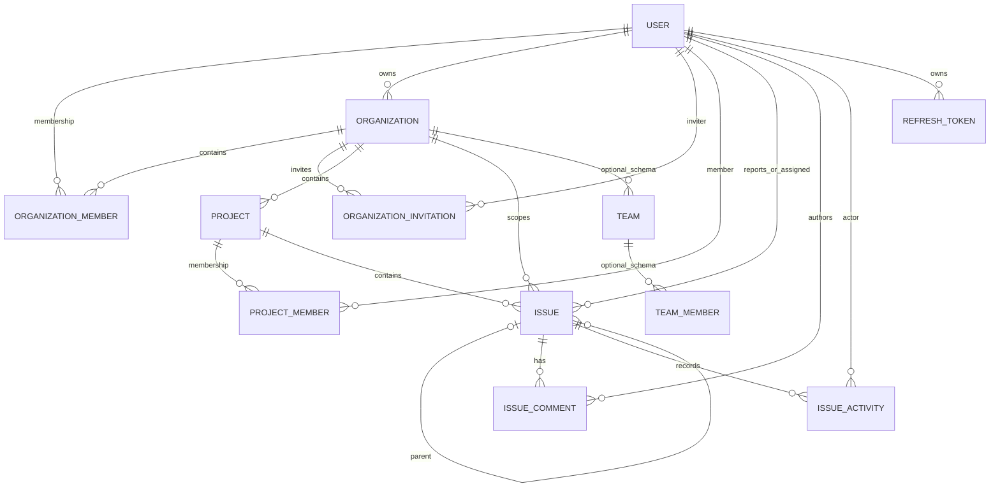

# Worklyn — UI and Product Context

> Repository-grounded handoff for an AI assistant implementing future Worklyn pages. Inspected on 2 November 2026. Source code is authoritative where this document or the older root `README.md` disagrees with the live implementation.
>
> **Privacy:** environment files, credentials, database contents, and the `state/` directory were not read. This document records environment variable names only and does not reproduce private network host values. Postman collections were not used as a source of truth.

## 1. What Worklyn Is

Worklyn is a MERN project and issue management application. Its data model organizes work as **Organization → Project → Issue**. Organizations own projects; active organization and project memberships control access. Issues can be assigned, filtered, updated through a constrained status path, commented on, and associated with one-level subtasks.

The repository now includes a functioning first client slice: account registration and email OTP verification, login/session restore, organization creation and switching, an authenticated application shell, and a personalized Home page. The app does **not** yet have project detail, issue detail, backlog, sprint planning, or board pages. Several navigation choices are intentionally marked “Soon.” A project’s `SCRUM` or `KANBAN` type is metadata only; it does not mean a board exists.

### Product/design intent

The established visual direction is **Workshop Signal**: quiet mineral neutrals, dark green ink, restrained lime accents, legible status colors, compact developer-oriented identifiers, and calm long-session use. Keep the interface distinctive and polished without copying Jira’s shell or adding generic dashboard charts. Show only data the API actually returns or data transparently derived from it.

## 2. Repository and Stack

```text
.
├── README.md                       # Older repository brief; portions are stale
├── uidesign.md                     # This current UI and product handoff
├── client/
│   ├── index.html
│   ├── package.json / package-lock.json
│   ├── vite.config.js
│   ├── public/                     # Brand logo and favicon images
│   └── src/
│       ├── App.jsx                 # Auth loading gate + route tree
│       ├── main.jsx                # StrictMode, BrowserRouter, AuthProvider
│       ├── index.css               # Tailwind v4 theme tokens and body styles
│       ├── App.css                 # Legacy custom CSS; not imported by current entry
│       ├── routes/                 # Route table and access guards
│       ├── pages/                  # Login, registration, home, organization creation
│       ├── context/                # Auth and organization/project state
│       ├── components/layout/      # Shell, sidebar, navbar, menus, icons
│       ├── components/dashboard/   # Home dashboard pieces
│       ├── components/issues/      # Status and priority display primitives
│       └── lib/                    # API, feature flags, issue metadata, hooks
├── server/
│   ├── server.js / app.js
│   ├── routes/ controllers/ services/
│   ├── middlewares/ validators/ models/ utils/ config/
│   └── package.json / package-lock.json
├── postman/ and .postman/          # Not inspected; do not treat as verified API docs
└── state/                          # Private/user state; intentionally not inspected
```

Generated folders such as `node_modules`, `dist`, and `.git` are excluded from this map. The current modified files in the client/server were already present in the working tree when this documentation task began; this task adds only `uidesign.md`.

| Layer | Declared stack |
|---|---|
| Client | React `^19.2.8`, React DOM `^19.2.8`, React Router `^8.5.1`, Vite `^8.3.0`, Tailwind CSS `^4.3.3`, `@tailwindcss/vite` `^4.3.3`, `lucide-react` `^1.66.0` |
| Server | Node.js/CommonJS, Express `^5.2.1`, Mongoose `^9.10.2`, `jsonwebtoken`, `bcryptjs`, `cookie-parser`, `cors`, `dotenv` |
| Database | MongoDB via Mongoose |
| Client state | React Context + component state; no Redux or query-cache library |
| Forms | Native form elements and handwritten validation; no form library |
| Build/lint | Vite; ESLint. Client has `dev`, `build`, `lint`, `preview` scripts. Server test script is a placeholder that exits with “no test specified.” |

No application test suite, CI/deployment manifest, Docker configuration, upload service, email provider, websocket, job queue, or scheduler was found. Package versions are declared ranges, not verified installed runtime versions.

### Environment names (values intentionally omitted)

Names referenced in source: `PORT`, `MONGO_URI`, `JWT_ACCESS_SECRET`, `JWT_REFRESH_TOKEN`, `NODE_ENV`, `FRONTEND_URL`, and client `VITE_API_URL`. Do not add actual values to design docs or frontend source. The client API module contains a fallback network URL; its host is intentionally not reproduced here. The Express CORS allowlist includes localhost plus a network-specific client origin; the latter is intentionally not reproduced. The server defaults to port 5000 and listens on `0.0.0.0`.

## 3. Current UI Routes and Status

Defined in `client/src/routes/index.jsx`. All route paths below are actual client routes, unlike the numerous future pages in prior product notes.

| Path | Component | Access | What it currently does | Data/API |
|---|---|---|---|---|
| `/login` | `client/src/pages/LoginPage.jsx` | Public-only; authenticated users are redirected | Email/password login, show/hide password, field/server errors, verification-required state and resend-code action | `POST /api/auth/login`, `POST /api/auth/resend-verification` |
| `/register` | `client/src/pages/RegisterPage.jsx` | Public-only | Account form → six-digit email verification → verified success screen with link to login. UI applies a 30-second resend cooldown; server OTP expires after 10 minutes. | `POST /api/auth/register`, `/verify-email`, `/resend-verification` |
| `/` | `client/src/pages/HomePage.jsx` within `AppShell` | Protected | Greeting/date, organization context, 4 summary tiles, up to 6 project summaries, “For you” tabs, issue status breakdown | Auth context; organization/project context; up to 100 assigned issues per project for first 10 projects |
| `/organizations/new` | `client/src/pages/CreateOrganizationPage.jsx` within `AppShell` | Protected | Creates organization; name auto-generates URL slug unless manually edited; optional description; live sidebar preview; success selects organization and returns Home | `POST /api/organization`; organization context update |
| `*` | `Navigate` | Public fallback | Redirects unknown paths to `/` (protected guard then redirects to `/login` if signed out) | None |

`ProtectedRoute` and `PublicOnlyRoute` are in `client/src/routes/`. The app waits for `AuthProvider` session restore before rendering routes, so protected pages do not flash unauthenticated content. There is no route for issue detail, project detail, invitation acceptance, teams, members, or settings. Invitation API URLs point to `/accept-invitation`, but that client route currently does not exist.

## 4. Current App Shell and Reusable UI

### Main shell

- `components/layout/AppShell.jsx`: wraps protected content in `OrganizationProvider`; renders responsive `Sidebar`, `Navbar`, `<Outlet>`, and `CommandPalette`. Adds skip-to-content link. Sidebar collapse preference uses localStorage key `worklyn:sidebarCollapsed`.
- `components/layout/Sidebar.jsx`: Home link; Personal nav entries Recent, Starred, Notifications; Workspace entries Projects, Teams, Members; current project list. Only Home is currently enabled among these navigation sections; project-page support is false. Disabled nav is displayed as “Coming soon.” On desktop sidebar supports collapsed rail; on mobile it becomes a drawer.
- `components/layout/Navbar.jsx`: current organization + current page breadcrumb, keyboard-search trigger, Create menu, Notifications/Help/Settings popovers, account menu. Breadcrumb title map currently knows `/` and `/organizations/new`.
- `components/layout/OrgSwitcher.jsx`: switch among organizations loaded from API and link to create an organization. Selected org is remembered in browser storage by the context.
- `components/layout/CommandPalette.jsx`: `Ctrl+K` / `⌘K`, keyboard-up/down/Enter/Escape, searches Home, project names, other organizations, create organization, sign out. It does not search issues. Project destinations are disabled while `FEATURES.projectPages` is false.
- `components/layout/CreateMenu.jsx`: Issue and Project entries are disabled by feature flags; Organization navigates to `/organizations/new` and is enabled.
- `components/layout/UserMenu.jsx`: profile identity and sign out; mobile Help and Settings explanatory content.
- `components/layout/NavPopover.jsx`: reusable popover for notifications/help/settings. Notifications and settings are explanatory placeholders, not live functionality.
- `components/layout/icons.jsx`: one consistent Lucide icon wrapper (18px, 1.75 stroke).
- `components/AuthShell.jsx`: shared auth-page two-column responsive shell, field/input/link primitives, and logo.
- `components/SessionLoading.jsx`: session restore loading indicator.
- `components/issues/IssueBadges.jsx`: `StatusChip` and `PriorityMark` based on real issue enums.
- `components/dashboard/StatTile.jsx`, `StatusBreakdown.jsx`, `ProjectList.jsx`, `ForYou.jsx`: Home dashboard primitives. `ForYou` changes to a select-like menu at small screens and a keyboard-operable tablist on wider screens.
- `lib/useDismiss.js`: outside click/Escape close for popovers.

### Current Home data and interpretation

`HomePage.jsx` derives all figures from organization/project membership and issues assigned to the current user. It does not call a reporting API.

- **Projects:** count of active projects returned for the selected organization/current member.
- **Open, assigned to me:** loaded issues whose status is not `DONE`.
- **In progress:** loaded assigned issues with `IN_PROGRESS` only (not `IN_REVIEW`).
- **Overdue:** loaded assigned issues with a due date before local start of today and not `DONE`.
- **Work by status:** distribution of loaded assigned issues.
- **For you / Recommended:** open assigned issues that are overdue, high/highest priority, or `IN_PROGRESS`, sorted overdue first, then priority, then due date.
- **Assigned to me:** all loaded open assigned issues.
- **Worked on:** all loaded assigned issues sorted by `updatedAt`; this is not an activity feed and does not prove that the current user performed the update.
- Only 8 items are shown in a For You list by default. Up to 100 issues are requested per project, and the hook scans only the first 10 projects. UI warns when some project requests fail; status breakdown text notes the 100-per-project/10-project cap.
- `ProjectList` shows up to 6 projects. Project cards are not links while project pages are disabled.
- “Starred” and “Viewed” tabs are shown as coming soon; they are not data-backed.

Potential current UI mismatch to inspect when implementing issue pages: the API/model field is `issueKey`, while `ForYou.jsx` currently renders `i.key`; verify/fix the display mapping in a future UI change. The shared `useMyIssues` hook merges `projectKey` but does not currently use it in the row.

### Feature flags (`client/src/lib/features.js`)

```js
recent: false
starred: false
notifications: false
projectsList: false
projectPages: false
teams: false
members: false
createIssue: false
createProject: false
createOrganization: true
settings: false
```

The flags currently gate UI exposure only; they do not create backend features or access control.

## 5. Frontend State, API Client, and Session Rules

### Authentication (`context/AuthContext.jsx`)

- `main.jsx` nests `BrowserRouter` and `AuthProvider` inside `StrictMode`.
- On startup `AuthProvider` POSTs refresh cookie to `/api/auth/refresh`, then GETs `/api/auth/me` with the returned access token.
- An in-flight promise is shared during StrictMode double effects because refresh tokens rotate and the same cookie cannot safely be refreshed twice concurrently.
- Access token is held in React/module memory (`session` plus `lib/api.js` memory); it is not persisted in localStorage/sessionStorage. Refresh token is an HttpOnly cookie and must never be read by JavaScript.
- API client refreshes once after 401 on authenticated requests and notifies AuthContext if the session expires. Concurrent refreshes share a promise.
- Logout calls `/api/auth/logout`, then drops local session even if request fails.

### Organization/project state (`context/OrganizationContext.jsx`)

- Loads `/api/organization/my`; normalizes membership response into `{ id, name, slug, role }`.
- Selects stored `worklyn:orgId` if still available, otherwise first returned organization; selection is convenience state in localStorage, not authority.
- Loads `/api/organizations/:organizationId/projects/my`; normalizes each entry to `{ id, name, key, role }`.
- Exposes statuses/errors, `switchOrg`, `addOrganization`, and `reloadOrgs`.

### API client (`lib/api.js`)

- Base path is `${import.meta.env.VITE_API_URL || <source-configured fallback>}/api`. Do not copy the fallback host into docs or examples.
- `fetch` uses `credentials: "include"`; JSON bodies add `Content-Type`; bearer token is added when in memory.
- `ApiError` carries `message`, `status`, and normalized `fieldErrors` from backend `errors` (supports object or array shapes).
- Request helpers currently include auth, organization list/create, project list, and issue list. No project detail/create, member listing, issue mutation, comments, activities, teams, or upload helpers are present in the client API module.
- The API client comments say issue response key is not documented; the current backend controller confirms `data` is the issue array and `pagination` is a sibling property.

### CORS and cookies

`server/app.js` uses `cors` with credentials and a hard-coded origin allowlist (localhost plus a network-specific origin whose value is intentionally omitted). Refresh cookies are HttpOnly, have a seven-day max age, `secure` in production and `SameSite=None` in production / `Lax` otherwise. Cross-origin production requires correct HTTPS, allowed origin, credentials, and cookie settings. Do not assume the configured local origins cover a different deployment. No Vite proxy is currently configured.

## 6. Backend Architecture

```mermaid
flowchart LR
  Browser[React + Vite]
  Router[React Router + protected shell]
  Context[AuthContext / OrganizationContext]
  Client[client lib/api.js]
  Express[Express app + CORS + cookie parser]
  MW[JWT / organization / project access]
  Controller[Route controller + validator]
  Service[Domain service]
  Model[Mongoose models]
  Mongo[(MongoDB)]
  Browser --> Router --> Context --> Client --> Express --> MW --> Controller --> Service --> Model --> Mongo
```



`server/server.js` loads dotenv, starts the database connection, then listens on `PORT` (default 5000) at `0.0.0.0`. `server/app.js` installs JSON parsing, cookie parsing, credentialed CORS, and mounts route modules. Controllers call validators/services; services perform Mongoose operations. There is no central error middleware or OpenAPI schema.

## 7. Authentication and Authorization Contract

- Protected routes require `Authorization: Bearer <accessToken>`; `authenticate.js` verifies with `JWT_ACCESS_SECRET`, loads the user while excluding password hash, OTP, OTP expiry and social IDs, and rejects missing/deleted/deactivated/unverified users.
- Organization access requires an active `OrganizationMember` record. Owner/admin checks use `authorizeOrganization`.
- Project access requires both active organization membership and active `ProjectMember` membership, and only active projects pass `projectAccess`.
- Project admin checks use `authorizeProject("PROJECT_ADMIN")`.
- Issue detail separately verifies active project and organization membership in `issue.service.js`; issue activity route uses `issueAccess`.
- `VIEWER` project members cannot update issues; issue comments require membership, and edit/delete is author-only in the service.
- Access tokens are returned in JSON. Refresh tokens are set as HttpOnly cookie; DB stores refresh token hashes, expiry, revocation time, user agent and IP.
- Registration OTP is generated and logged by backend service rather than delivered by an email integration. Do not claim email delivery is implemented.

## 8. Actual Backend API Inventory

All application endpoints below use the `/api` prefix. JSON success responses generally use `{ success: true, message?, data }`; validation failures may include `errors`; errors are not completely consistent between controllers. Auth column means Bearer access token unless cookie is stated. Request bodies are JSON. Never put credential/token values in design documentation.

### Authentication — `/api/auth`

| Method + path | Auth | Request | Success response / behavior |
|---|---|---|---|
| `POST /auth/register` | Public | `{ firstName, lastName, email, password, mobile? }`; name min 2, password min 8, email regex | `201 { success, message, data: { userId, email } }`; creates unverified local user and 10-minute OTP. Duplicate email returns 409. OTP is logged server-side; there is no email sender. |
| `POST /auth/verify-email` | Public | `{ userId, otp }`, OTP exactly six digits | `200 { success, message, data: { userId, email, isVerified } }`; invalid/expired/already verified errors return 400. |
| `POST /auth/resend-verification` | Public | `{ email }` | `200 { success, message, data: { email } }`; creates new 10-minute OTP and logs it. |
| `POST /auth/login` | Public | `{ email, password }` | `200 { success, message, data: { user, accessToken } }`; sets `refreshToken` HttpOnly cookie. User fields returned: `id`, names, email, profileImage, isVerified. Invalid credentials/account state returns 401. |
| `GET /auth/me` | Bearer | No body | `200 { success, data: { user } }`; middleware-selected user object. |
| `POST /auth/refresh` | Refresh cookie | No body | Rotates cookie and returns `200 { success, message, data: { accessToken } }`; any refresh error returns 401 and clears cookie. |
| `POST /auth/logout` | Refresh cookie; no Bearer middleware | No body | Revokes stored refresh token if found, clears cookie, returns success message. |

### Organizations and invitations

| Method + path | Auth / permission | Request | Success response / behavior |
|---|---|---|---|
| `POST /api/organization` | Bearer | `{ name, slug, description? }`; name/slug min 2; slug lowercase alphanumeric/hyphen | `201 data.organization`; also creates caller’s OWNER membership. |
| `GET /api/organization/my` | Bearer | None | `200 data.organizations[]`, each `{ organization, role, membershipId }`, active memberships only. |
| `GET /api/organization/:organizationId` | Active org member | None | `200 data: { organization, role }`. |
| `PUT /api/organization/:organizationId` | Owner/Admin | Optional `name`, `description`, `logo`; name min 2, description max 500 | `200 data.organization`. |
| `GET /api/organization/:organizationId/members` | Active org member | None | `200 data.members[]`; populated user includes first/last name, email, profileImage. Active only. |
| `POST /api/organization/:organizationId/invitations` | Owner/Admin | `{ email, role }`; role `ADMIN` or `MEMBER` | `201 data: { invitation, invitationLink }`. Link is returned for development; no email delivery. Token stored hashed, expiry 7 days. |
| `DELETE /api/organization/:organizationId/invitations/:invitationId` | Owner/Admin | None | Marks pending invite cancelled; returns updated invitation. |
| `POST /api/organization/:organizationId/invitations/:invitationId/resend` | Owner/Admin | None | Rotates token and extends expiry 7 days; `data: { invitation, invitationLink }`. |
| `PATCH /api/organization/:organizationId/members/:memberId/role` | Owner only | `{ role: "ADMIN" | "MEMBER" }` | `200 data.member`; cannot change OWNER role. |
| `DELETE /api/organization/:organizationId/members/:memberId` | Owner only | None | Soft changes membership to REMOVED; owner cannot be removed. |
| `DELETE /api/organization/:organizationId/leave` | Active org member | None | Soft removes caller membership; owner must transfer ownership first. |
| `PATCH /api/organization/:organizationId/transfer-ownership` | Owner only | `{ newOwnerMemberId }` | Transaction updates org owner, previous owner becomes ADMIN, target becomes OWNER. Response includes organization, previousOwner, newOwner. |
| `POST /api/invitations/accept` | Bearer; account email must match invited email | `{ token }` | `200 data: { organization, role }`; activates/creates membership and marks invite accepted. |

There is **no API to list pending invitations**, and no client invitation-accept route. Organization member listing exists, but no project member listing endpoint exists.

### Projects and project membership

| Method + path | Auth / permission | Request | Success response / behavior |
|---|---|---|---|
| `POST /api/organizations/:organizationId/projects` | Active org member + Owner/Admin | `{ name, key, slug, description?, projectType?, lead? }`. Name min 2; key 2–10 alphanumeric starting letter; slug lowercase alphanumeric/hyphen; type SCRUM/KANBAN. | `201 data.project`; creator is automatically PROJECT_ADMIN. Duplicate key/slug returns 409. |
| `GET /api/organizations/:organizationId/projects/my` | Active org member | None | `200 data.projects[]`, each `{ project, role, membershipId }`; caller active memberships in active projects only. |
| `GET /api/projects/:projectId` | Active org + project member | None | `200 data: { project, role }`. |
| `POST /api/projects/:projectId/members` | Project admin | `{ userId, role: "MEMBER" | "VIEWER" }` | `201 data.membership`; target must already be active org member. |
| `PATCH /api/projects/:projectId/members/:memberId/role` | Project admin | `{ role: "MEMBER" | "VIEWER" }` | `200 data.membership`. |
| `DELETE /api/projects/:projectId/members/:memberId` | Project admin | None | Soft removes; cannot remove last active PROJECT_ADMIN. |

No project archive/update/settings API, project member-list API, or create-project frontend page is present. `Project.settings` exists as a mixed schema field but does not imply API-backed UI settings.

### Issues, activities, comments

| Method + path | Auth / permission | Request/query | Success response / behavior |
|---|---|---|---|
| `POST /api/projects/:projectId/issues` | Active org + project member | `{ title, description?, type?, priority?, assigneeId?, parentIssueId?, labels?, dueDate?, estimate? }` | `201 data.issue`. New status is TODO. Issue key is project key + incrementing number. |
| `GET /api/projects/:projectId/issues` | Active org + project member | Query `page` default 1, `limit` default 10 max 100; optional `status`, `type`, `priority`, `assignee`, `search` | `{ success, message, data: Issue[], pagination: { page, limit, total, totalPages, hasNextPage, hasPrevPage } }`. Sorted updatedAt desc then ID desc. Search is title/key case-insensitive. Assignee may be ID or literal `unassigned`. Reporter, assignee, parentIssue populated. |
| `GET /api/issues/:issueId` | Bearer; service requires active org and project membership | None | `200 data: Issue`, with reporter/assignee/parentIssue populated. |
| `PATCH /api/projects/:projectId/issues/:issueId` | Active org/project member; VIEWER forbidden | Patch one or more of `title`, `description`, `status`, `priority`, `type`, `assignee`, `labels`, `dueDate`, `estimate` | `200 data: Issue`, populated. Empty/unknown update fields rejected. On change, records `IssueActivity`. |
| `GET /api/issues/:issueId/activities` | Bearer + active org/project membership through `issueAccess` | None | `200 data: Activity[]`; latest 100, newest first, actor populated with name/profile image. |
| `POST /api/projects/:projectId/issues/:issueId/comments` | Active org/project member | `{ body }`, trimmed 1–5000 chars | `201 data: Comment`, populated author. |
| `GET /api/projects/:projectId/issues/:issueId/comments` | Active org/project member | `page` default 1; `limit` default 10 max 100 | `200 data: Comment[]`, sibling pagination metadata. |
| `PATCH /api/projects/:projectId/issues/:issueId/comments/:commentId` | Active org/project member + author only | `{ body }`, 1–5000 chars | `200 data: Comment`; sets `editedAt`. |
| `DELETE /api/projects/:projectId/issues/:issueId/comments/:commentId` | Active org/project member + author only | None | Soft deletes (`deletedAt`, body becomes `[deleted]`); returns comment ID. |

Issue enums and rules:

- Type: `EPIC`, `STORY`, `TASK`, `BUG`, `SUB_TASK` (default TASK).
- Status: `BACKLOG`, `TODO`, `IN_PROGRESS`, `IN_REVIEW`, `DONE` (new issue default TODO).
- Priority: `LOWEST`, `LOW`, `MEDIUM`, `HIGH`, `HIGHEST` (default MEDIUM).
- Title 3–200 chars; description up to 10,000; labels up to 20 strings of 1–50 chars; estimate nonnegative; due date must parse.
- Assignee must be an active member of both project and organization.
- A SUB_TASK must reference a same-project non-subtask parent. Subtask-of-subtask is rejected. No broader issue-link relationships exist.
- Allowed transitions: BACKLOG→TODO; TODO→BACKLOG or IN_PROGRESS; IN_PROGRESS→TODO or IN_REVIEW; IN_REVIEW→IN_PROGRESS or DONE; DONE→IN_REVIEW. Same status can be sent but produces no change record.
- `IssueActivity` supports `ISSUE_CREATED`, but issue-creation service currently does not create that activity. Updates create `ISSUE_UPDATED` or `STATUS_CHANGED` with `{ field, from, to }` entries only when values differ.

There is no issue board ordering/ranking API, sprint API/model, global search API, saved filters, issue attachment support, notifications, report aggregation, or upload integration. The model having issue types or a project type does not implement their broader Jira workflows.

## 9. Domain Model and Relationships

Mongoose document references are used; they are not SQL foreign keys. Most schemas use timestamps. See `server/models/` for exact schema constraints.

| Model | Important fields/constraints |
|---|---|
| `User` (`models/user.js`) | Required first/last name (trimmed, max 50); unique lowercase email; optional unique sparse mobile; passwordHash; profileImage; isVerified; deactivatedAt/isDeleted/deletedAt; OTP + expiry; Google/Facebook IDs; lastLoginAt; provider enum local/google/facebook. Provider fields do not prove OAuth endpoints exist. |
| `RefreshToken` | User ref, unique tokenHash, expiresAt, revokedAt, userAgent, ipAddress; timestamps. |
| `Organization` | Required name (max 100), unique lowercase slug, description max 500, logo, owner User ref, mixed settings, isActive; timestamps. |
| `OrganizationMember` | Org/User refs; role OWNER/ADMIN/MEMBER; status ACTIVE/INVITED/SUSPENDED/REMOVED; invitedBy, joinedAt; unique `{ organization, user }`. |
| `OrganizationInvitation` | Org ref, lowercase email, role ADMIN/MEMBER, unique tokenHash, inviter, status PENDING/ACCEPTED/REJECTED/EXPIRED/CANCELLED, expiresAt + lifecycle timestamps; compound org/email/status index. |
| `Project` | Organization ref, name, uppercase key (2–10), slug, description max 1000, avatar, projectType SCRUM/KANBAN, lead/creator User refs, status ACTIVE/ARCHIVED, mixed settings, nonnegative issueCounter; unique organization+key and organization+slug. |
| `ProjectMember` | Project/User refs; role PROJECT_ADMIN/MEMBER/VIEWER; status ACTIVE/INVITED/REMOVED; invitedBy, joinedAt; unique `{ project, user }`. |
| `Issue` | Org/Project refs; issueNumber, issueKey; title/description; type/status/priority enums above; reporter, optional assignee, optional parentIssue refs; labels, dueDate, estimate, archivedAt; unique project+number and project+key; project/status/createdAt query index. |
| `IssueComment` | Org/Project/Issue/author refs; body 1–5000; editedAt/deletedAt; timestamps; issue/deletedAt/createdAt index. |
| `IssueActivity` | Org/Project/Issue/actor refs; allowed action enum; changes array of field/from/to; timestamps; issue+createdAt index. |
| `Team` | Organization ref, name, description, avatar, createdBy, isActive; unique organization+name. **Schema only; no team API or UI.** |
| `TeamMember` | Team/User refs, TEAM_LEAD/MEMBER, ACTIVE/INVITED/REMOVED, joinedAt; unique team+user. **Schema only; no team API or UI.** |



Diagram cardinalities describe references/conceptual navigation; they do not imply cascade deletion or complete database-level referential integrity.

## 10. Current Workflows

### Register → verify → sign in

`RegisterPage` validates name/email/password client-side, calls register, stores returned userId/email in component state, then requests/verifies a six-digit code. Resend has a UI cooldown. Backend creates a 10-minute OTP and logs it to server output; production email delivery is missing. On success the page offers navigation to login. Login calls API, AuthContext stores access token in memory and backend sets refresh cookie. On reload, auth provider rotates refresh token and fetches `/me` before showing protected content.

### Create organization → home

An authenticated user opens `/organizations/new`. UI validates name, slug, optional description; slug is auto-derived from name until manually changed. API creates Organization and OWNER membership. Context adds/selects it, then navigates Home. The home/sidebar loads projects for that org. There is no create-project form yet.

### Home assigned-work summary

Organization context fetches current organizations and projects. `useMyIssues` requests issues assigned to the user for up to ten projects, each with `limit=100`, using the existing project issue listing endpoint. Home derives metrics/tabs from these fetched records. This is a bounded personal-work view, not a true analytics dashboard. Errors are partial if some project requests succeed and others fail.

### Project and issue operations

Backend supports project creation/membership, issue create/list/detail/update, comments, and activity, but current client does not expose those flows (except reading assigned issues on Home). Future UI must use the actual API fields/statuses and role constraints above. There is no working board/backlog/sprint workflow in the client or backend.

## 11. Current UX and Design System

### Tailwind v4 design tokens

Defined using `@theme` in `client/src/index.css`; use Tailwind v4 conventions and preserve `@tailwindcss/vite`.

| Token | Value | Role |
|---|---|---|
| canvas | `#F4F5F2` | App background |
| surface | `#FFFFFF` | Main panels |
| surface-subtle | `#EAEEE9` | Secondary areas |
| ink | `#17231D` | Primary text |
| ink-muted | `#59665F` | Secondary text |
| ink-faint | `#748078` | Muted text; do not use for essential low-contrast copy |
| line | `#D8DED8` | Borders |
| accent | `#B8F04A` | Lime action/highlight with dark ink foreground |
| accent-strong | `#8FCA24` | Accent hover |
| accent-support | `#316B59` | Supporting green, links/focus |
| danger | `#B33C3C` | Destructive/error |
| status backlog | `#6E7880` | Backlog |
| status todo | `#316B9A` | To do |
| status progress | `#8A5A00` | In progress |
| status review | `#8053A6` | In review |
| status done | `#26734D` | Done |
| priority low | `#68766E` | Low/lowest |
| priority medium | `#316B9A` | Medium |
| priority high | `#B26017` | High |
| priority highest | `#B33C3C` | Highest |

Sans and mono stacks are system-based. Named Tailwind radii: `rounded-control` 6px and `rounded-panel` 10px; additional UI uses 14px for dialogs. Current styling mostly uses utility classes. `App.css` contains a large earlier custom dashboard draft but is not imported by current `main.jsx`; do not assume its selectors are live.

### Interaction/accessibility patterns already present

- Semantic `main`, `nav`, headings, forms, labels, button types, alerts/status messages, `aria-*`, and skip-to-main link in shell.
- Visible focus rings, error associations, focus of first invalid field, `aria-busy` submit buttons, and show/hide password on auth forms.
- Escape/outside-click closes menus/popovers; command palette supports keyboard operation and focus restore.
- Reduced motion is included in many Tailwind animation/transition classes via `motion-reduce`.
- Responsive auth two-column layout; shell uses mobile drawer; desktop collapse; Home uses responsive grid; ForYou uses tabs desktop / dropdown mobile.
- Future pages should keep these patterns consistent. Review contrast, focus trapping, menu semantics and touch targets as pages are added; current implementation is not a formal accessibility audit.

## 12. Missing Features, Current Limitations, and Integration Notes

### Pages/features absent

- Project list/detail route and create-project screen (project cards are display-only).
- Issue list/detail page, issue create/edit UI, project member list UI.
- Backlog ordering, Scrum/Kanban board, drag/drop, sprint entity/planning, burndown/velocity.
- Pending invitation list, invitation accept page, notifications inbox, global issue search, saved filters.
- Teams and team membership API/UI despite schemas; profile edit/settings; attachments/uploads; reports/dashboards; OAuth/password reset.
- Email sender: OTP prints to server log and invitation links are returned in API response for development.

### Confirmed mismatches/risks for future AI implementers

1. Root `README.md` describes the frontend as a placeholder with no routes. That was true in an earlier state and is now stale; use this document and source tree.
2. `ForYou.jsx` reads `i.key`, while the issue model/API field is `issueKey`; check this before reusing the row for issue-key UI.
3. `lib/api.js` comment says issue response array key is undocumented, but current `issue.controller.js` returns an array at `data` and pagination beside it.
4. `OrganizationContext` has a comment that response nesting is undocumented; controllers confirm organization/project membership entries are `{ organization|project, role, membershipId }`.
5. `GET /api/projects/:projectId` exists, but no helper/page currently calls it. `GET /api/organization/:id/members` exists, but no project member list endpoint exists.
6. CORS origins are hard-coded. Deployment must coordinate origin and cookie settings; do not silently copy the source’s network host into docs/config.
7. There is a model filename casing inconsistency: actual file `server/models/user.js` but backend imports commonly use `../models/User`. Windows may tolerate this; case-sensitive deployment may not. Avoid changing unrelated files in a UI task, but report/resolve separately before Linux deployment.
8. Source uses `JWT_REFRESH_TOKEN`; prior README mentioned a different refresh-secret variable name. Treat source as canonical and never record values.
9. Issue creation activity is not persisted though model enum includes ISSUE_CREATED.
10. The current Home “Worked on” tab is based on `updatedAt` of assigned issues and is not a user activity history.

### Backend constraints that should shape UI

- No project-member listing endpoint: do not invent an assignee list. An issue form needs a backend member-list API or a separately confirmed source.
- No invitation-list endpoint: invitation management cannot display a pending-invite table from current API.
- No issue list sort control: API sorting is fixed by latest update.
- Pagination limit max 100; aggregate counts must state the loaded scope/page. Existing Home scans up to 10 projects.
- No notifications/events are emitted for assignment, comments, or status changes.
- No API global search; issue search is scoped to one project and matches issue title/key.
- There is no board order field or persistence contract. Do not build drag/drop as if order will persist.

## 13. Guidance for Building the Remaining UI

### Recommended next-page sequence

1. **Project list/create**: use real organization project memberships and actual project-create fields (name, key, slug, description, projectType, optional lead). Project creation requires organization OWNER/ADMIN. Creator becomes PROJECT_ADMIN. There is no user/member picker endpoint for `lead` beyond authenticated user; omit optional lead or default caller.
2. **Issue list**: project scoped; support only backend filters (status/type/priority/assignee/search), pagination, and fixed updated-time ordering. Derive visible counts only from loaded data and label their scope.
3. **Create issue**: title, description, type, priority, optional labels/due date/estimate; assignment requires project member list first. Subtasks require a same-project non-subtask parent. Backend create field is `assigneeId`, while update field is `assignee`.
4. **Issue detail**: GET issue, PATCH supported fields, comments and activity endpoints; preserve transition constraints and viewer read-only behavior. Do not invent related issue links or attachments.
5. **Organization member/invitation management**: list members API exists; invitation create/cancel/resend exists, but there is no pending-invitation list route. A functional invite history needs backend support.
6. Only after models/endpoints are added should sprint, board, notification, analytics, team, or attachment pages appear as functional destinations.

### Implementation rules

- Keep React 19 + React Router + Vite + Tailwind v4. `react-router` is the router package imported by source; do not assume `react-router-dom`.
- Preserve existing `AuthProvider`, `OrganizationProvider`, `lib/api.js` token refresh/retry logic, route guards and route table. Do not store access or refresh tokens in localStorage; access token is memory-only, refresh token is HttpOnly cookie.
- Add pages in `client/src/pages/`, route declarations in `client/src/routes/index.jsx`, reusable shell/presentation components under `components/`, API calls in `lib/api.js`, and feature flags only as UI visibility gates.
- Use organization/project contexts for existing shared data. Avoid duplicating global auth/org fetch logic inside pages.
- Keep API base configuration centralized. `VITE_API_URL` is a **base origin** joined with `/api`; do not hardcode the existing network fallback into new components or docs.
- Use `lucide-react` consistently; don’t add another icon library. Avoid adding data-state/form/motion libraries unless a clear requirement is identified.
- Preserve response envelope details from controller source. Use API client errors/field errors rather than assuming every error has the same format.
- Always include loading, empty, recoverable error, permission, validation, and success states as relevant. Preserve form input after server rejection.
- Do not use placeholder productivity charts, fake counts, fake users, fake avatars, fake notifications, sample projects/issues in production states.
- Keep color semantic but add text/icon labels; status meaning must not depend on color alone. Keep motion restrained and honor reduced motion.

## 14. Copy-ready Context for a Future AI

### MASTER CONTEXT FOR CHATGPT, CLAUDE AND GOOGLE STITCH

Read all of `uidesign.md` before proposing or implementing additional Worklyn UI. Inspect current source files for any detail that has changed; the live code is the source of truth, and the older root `README.md` is stale about the frontend. Build on the current React 19, React Router, Vite, Tailwind CSS v4 architecture, AuthContext, OrganizationContext, API client, route guards and layout components. Preserve existing backend routes, request/response envelopes, roles, authentication, and cookie behavior. Keep access tokens in memory and never read or expose the HttpOnly refresh cookie. Use the Workshop Signal visual system: comfortable mineral backgrounds, dark ink text, restrained lime actions and real semantic status/priority colors. Make pages responsive, keyboard usable, screen-reader clear and reduced-motion aware. Design reusable React-friendly components and describe page hierarchy, data contracts, loading/empty/error/success/permission states, interactions, responsive behavior and acceptance criteria. Do not invent fields, endpoints, users, organization/project membership, counts, activity, reports, board order, sprints, attachments or notifications. Distinguish implemented behavior from proposed behavior. The repository currently has no project/issue pages and no sprint/board/notification/report APIs. Project type does not imply a board. If a UI requirement needs missing backend data, identify the specific API/schema gap before designing it as functional. Do not change credentials, environment files, database contents or private `state/` data. For a UI task, avoid unrelated backend edits; request separate approval when a missing backend capability needs to be implemented.
